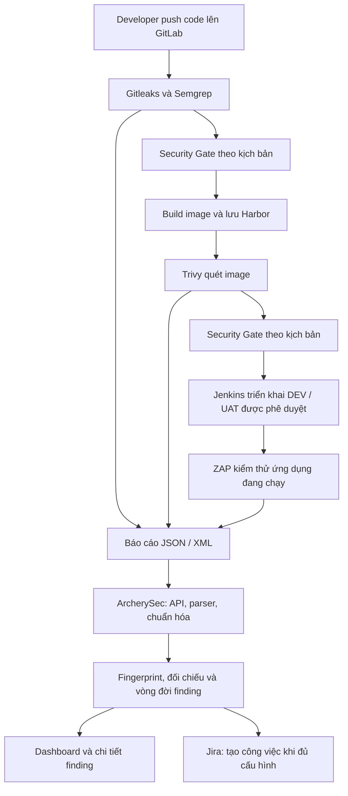

**Đối chiếu bản đồ án đã nộp và hướng dẫn giải thích sản phẩm — 14/11/2026**

Tài liệu gốc: [DO AN TOT NGHIEP - NGUUYEN DUC VIET 12112026.docx](../DO%20AN%20TOT%20NGHIEP%20-%20NGUUYEN%20DUC%20VIET%2012112026.docx).
Đối chiếu với working tree hiện tại của ArcherySec và các template CI cục bộ.
Tài liệu này được cập nhật sau quyết định khôi phục công thức fingerprint cũ.
DOCX và cấu hình CI giữ nguyên. Người dùng xác nhận Gate nằm ở GitLab và báo cáo
khác nhánh/môi trường được đẩy về các project ArcherySec khác nhau. Không suy ra
cấu hình GitLab/Jenkins/Jira đang chạy từ các file cục bộ. Các phép thử dưới đây
dùng dữ liệu minh họa và SQLite riêng.

**1. Những nội dung phải giữ đúng bản đã nộp**

| Nội dung trong đồ án | Hiện trạng đối chiếu | Kết luận |
| --- | --- | --- |
| Gitleaks, Semgrep, Trivy nhận JSON; ZAP nhận XML — Mục 2.3.2 | Registry vẫn dùng `gitleaks`, `semgrepscan`, `trivy`, `zap_scan`; định dạng không đổi | Phù hợp |
| REST API `POST /api/v1/uploadscan/`, multipart/form-data, X-API-KEY — Mục 2.3.3 | Các trường scanner, filename, project_id, scan_url vẫn được nhận | Phù hợp |
| Registry → parser riêng → chuẩn hóa → định danh → create/update → reconcile → thống kê — Hình 2.4 | Các bước còn đủ, nhưng một phần được chuyển sang module dùng chung | Kiến trúc phù hợp; thay vị trí hàm là refactor |
| Tạo fingerprint bằng biểu diễn xác định và SHA-256 — Mục 2.3.2 | Đã khôi phục payload fingerprint gốc cho bốn công cụ | Phù hợp; giữ hash tách khỏi định dạng dữ liệu hiển thị |
| Đối chiếu trong organization + project + scanner + fingerprint | Vẫn phân tách organization/project/scanner; khóa đối chiếu là dup_hash | Đã khôi phục theo ví dụ mã đã nộp |
| Một nhánh một project — Bảng 3.1, phần Hạn chế | Không thêm chiều branch vào mô hình finding | Phù hợp; lưu ý pipeline merge request và DEV/UAT ở mục 3 |
| Finding xuất hiện lại cập nhật bản ghi; Closed trở lại Open | Luồng tự động còn hoạt động | Phù hợp; Re-open là hành động chuyển trạng thái |
| Chỉ Auto-Close sau báo cáo hợp lệ, cùng phạm vi; báo cáo sạch khác báo cáo lỗi | Import có validation và transaction; báo cáo lỗi không làm sạch dữ liệu | Phù hợp mục tiêu đã mô tả |
| scan_id xác định lần quét; fingerprint đối chiếu finding | scan_id vẫn tạo mới; finding giữ UUID qua các lần nhận diện lại | Phù hợp ở vai trò; có thêm bảng liên kết lịch sử |
| Thống kê scan phục vụ lịch sử — đoạn cuối Mục 2.3.2 | Một số số đếm cũ được tính lại khi triage; chi tiết finding dùng dữ liệu hiện tại | Cần đánh giá, không phải lịch sử bất biến |
| Tạo việc Jira một chiều; cập nhật trạng thái sau khắc phục thủ công | Có tạo ticket, ghi lại jira_ticket và thêm comment khi phát hiện lại; chưa đồng bộ trạng thái hai chiều | Phù hợp giới hạn chính; có bổ sung comment |
| ArcherySec cung cấp dữ liệu; Security Gates nằm ở job CI — Mục 3.3.2 | Người dùng xác nhận đã cấu hình các Gate trên GitLab | Ngoài phạm vi sửa ArcherySec; không xem BYPASS trong file cục bộ là lỗi triển khai |
| DEV/UAT thuộc phạm vi; PROD ngoài thực nghiệm | File CI có trigger DEV tự động, UAT manual trên master | Phù hợp về cấu hình trigger; chưa xác minh Jenkins/runtime |
| Chưa khám phá tài sản/domain/IP tự động — Mục 2.2 và Hạn chế | Không bổ sung asset discovery | Phù hợp, không cần thêm trước bảo vệ |
| False positive đánh dấu thủ công, chưa có luật toàn cục | Vẫn thao tác thủ công theo project; giữ quyết định qua import | Phù hợp giới hạn chính |
| Chưa đồng bộ Slack/Teams/Telegram, chưa đánh giá tải | Không xác nhận có webhook hoặc khả năng chịu tải; có thông báo trong ứng dụng | Phù hợp; notification trong UI khác cảnh báo qua dịch vụ ngoài |

Bộ kiểm thử khôi phục có các hash mẫu lấy từ parser gốc, kiểm tra chuyển tiếp dữ
liệu và các ca vòng đời/UI. Kết quả kiểm thử không thay thế minh chứng thực nghiệm
trong DOCX. Cần đọc cùng các khác biệt còn lại dưới đây trước khi chốt bản demo.

**2. Khác biệt do các lần sửa gần đây cần đánh giá**

**2.1. Đã khôi phục khóa định danh cũ theo quyết định của người dùng.**

Mục 2.3.2 mô tả tìm finding bằng `dup_hash=duplicate_hash` và đưa ví dụ ZAP:

```text
SHA-256(canonical(scanner, title, severity, scan_url,
                 alert, instance, description, reference))
```

Code hiện tại đối chiếu bằng `dup_hash`, không còn dùng `identity_hash` để gộp
finding. Payload gốc đã được khôi phục:

| Công cụ | Định danh chính hiện tại |
| --- | --- |
| Gitleaks | Scanner + Fingerprint gốc; nếu thiếu Fingerprint: scanner/rule/file/start_line/commit |
| Semgrep | Scanner + check_id/severity/path/message/metadata/end/lines |
| Trivy vulnerability | Scanner + artifact_type/CVE/package/installed_version/fixed_version/title/severity/target/type/class |
| Trivy secret/config | Payload nội dung và vị trí theo loại như parser gốc, xem tài liệu khôi phục |
| ZAP | Scanner + title/severity/scan_url/alert/instance/description/reference như ví dụ trong quyển |

Ví dụ cùng rule và site của ZAP, chỉ sửa Description hoặc Reference:

- Công thức minh họa trong đồ án và code đã khôi phục: fingerprint thay đổi.
- Có thể tạo finding mới và đóng finding trước; UUID, note và ticket không được
  tự gộp giữa hai fingerprint khác nhau.

Không còn gộp ZAP chỉ theo rule/site khi bộ instances khác nhau. Hash sử dụng
giá trị nguồn theo công thức cũ; References để hiển thị vẫn được chuẩn hóa thành
link riêng. Semgrep INFO và ZAP riskcode 0 dùng Low khi băm, nhưng hiển thị
Informational. Cột identity_hash được giữ để tương thích schema/dữ liệu của
bản trung gian, không cần xóa dữ liệu hay thêm migration cho lần khôi phục.

Chi tiết chuyển tiếp và giới hạn dữ liệu từng bị gộp:
[legacy-fingerprint-restoration.md](legacy-fingerprint-restoration.md).

Nguồn: [report_formats.py](../scanners/report_formats.py),
[finding_lifecycle.py](../scanners/finding_lifecycle.py).

**2.2. Ánh xạ severity đã đổi — mức vừa, tác động số liệu UI.**

Trong Mục 2.3.2, Semgrep `INFORMATION → Low`. Hiện tại `INFO`,
`INFORMATION` được chuyển thành `Informational`. ZAP riskcode 0 hiện cũng là
Informational thay vì Low như logic cũ. Các thẻ Critical/High/Medium/Low chưa có
thẻ Informational riêng, trong khi tổng Open có thể bao gồm Informational.
Vì thế tổng Open có thể lớn hơn tổng bốn thẻ mức độ; không được giải thích đây
chỉ là khác màu sắc giao diện.

**2.3. Lịch sử scan có thêm liên kết và dùng finding chung — mức vừa.**

Thêm StaticScanFinding và WebScanFinding giúp mở được finding của báo cáo cũ.
Tuy nhiên các báo cáo đang cùng tham chiếu finding hiện tại: Description,
References và trạng thái có thể là giá trị mới nhất. Khi đánh dấu false positive,
code còn cập nhật số đếm của các scan được liên kết.

Phép thử: report R2 lúc upload có total_vul = 2; sau khi đánh dấu C false
positive, chính R2 có total_vul = 1. Do đó chưa thể gọi đây là snapshot bất biến
của kết quả từng lần quét như cách người đọc có thể hiểu đoạn thống kê lịch sử
ở cuối Mục 2.3.2.

**2.4. Chính sách lọc và kiểm tra report được bổ sung — cần ghi nhận.**

- Semgrep có `is_ignored=true` được bỏ qua; Trivy cấu hình PASS/EXCEPTION không
  được tính là finding đang Open. Đồ án không mô tả chi tiết các chính sách này.
- Semgrep có errors bị từ chối toàn bộ để bảo vệ Auto-Close. Điều này phù hợp
  nguyên tắc report hợp lệ trong đồ án, nhưng có thể khác cách pipeline đang xử
  lý errors, xem mục 3.
- Trivy đã đọc mọi secret và thêm filesystem vulnerabilities/mixed results.
  Đây là mở rộng xử lý; thực nghiệm chính của đồ án vẫn là quét Docker image.
- Khóa project khi import tuần tự hóa việc tìm/tạo theo dup_hash. Ràng buộc trên
  identity_hash của bản trung gian chỉ được giữ để tương thích schema. Các biện
  pháp này không chứng minh hệ thống đã kiểm thử tải hoặc chịu mọi mức đồng thời.

**2.5. Những thay đổi nhỏ, ít ảnh hưởng phần thuyết minh chính.**

Trang đăng nhập gọn hơn; dashboard thay bố cục; nhiều phần chi tiết được mở đồng
thời; References tách thành link riêng; Changelogs trỏ repository tùy biến;
notification trong ứng dụng và số liệu false positive được sửa. Tách adapter
parser khỏi hàm dùng chung cũng có thể là refactor, miễn là không đổi tập trường
định danh, cách quy đổi severity và các chính sách nghiệp vụ đã chốt.

**3. Ghi chú cấu hình ngoài phạm vi sửa ArcherySec**

**3.1. Gate do người dùng cấu hình trên GitLab.**

Người dùng xác nhận đã cấu hình chặn pipeline cho Kịch bản 2 trên GitLab. Bản
template cục bộ có BYPASS không phải bằng chứng Gate triển khai bị lỗi. Việc
khôi phục fingerprint không thay đổi Gate và không sửa cấu hình CI.

**3.2. Semgrep BYPASS và API xử lý errors chưa cùng chính sách.**

quality_scan.yml hiện coi phần tử trong `errors` là warning rồi tiếp tục upload.
API hiện từ chối báo cáo đó bằng HTTP 400; `curl --fail` làm job thất bại dù
BYPASS finding. Đây là một thay đổi có thể ảnh hưởng trực tiếp buổi demo, cần
chốt rõ báo cáo có lỗi quét có được coi là hoàn chỉnh hay không. Không nên chỉ
gọi mọi job thất bại là bị chặn vì phát hiện lỗ hổng.

**3.3. Phân luồng báo cáo theo project do GitLab cấu hình.**

Người dùng xác nhận các nhánh/môi trường được gửi về các project ArcherySec
khác nhau. Không thêm chiều branch/environment vào database và không thay
logic định tuyến đã cấu hình trên GitLab trong lần khôi phục này.

**3.4. Rủi ro trộn phạm vi chỉ áp dụng nếu gửi vào cùng project.**

Bảng 3.1 đặt nhánh master vào DEV/UAT với project Master-NodeGoat. Phạm vi
Auto-Close hiện là project + scanner, còn định danh ZAP có site URL. Phép thử:

```text
Upload DEV: finding ở https://dev.example.test → Open
Upload UAT vào cùng project: finding UAT → Open; finding DEV → Closed
```

Điều này không chứng minh DEV đã hết lỗi. Đây là ví dụ điều kiện giả định, không
phải lỗi đã xác nhận trên triển khai của người dùng. Với phân luồng project riêng
đã xác nhận ở trên, ví dụ đóng chéo này không áp dụng giữa hai project.

**3.5. Phạm vi Trivy và tình trạng triển khai.**

CI đang chạy `--scanners vuln --severity HIGH,CRITICAL --ignore-unfixed`; số liệu
ArcherySec phản ánh tập kết quả này. Không nên nói dashboard bao gồm mọi
severity hoặc cả CVE chưa có bản vá từ pipeline đó.

deploy_dev/deploy_uat kiểm tra Jenkins chấp nhận yêu cầu HTTP; job GitLab thành
công ở bước trigger chưa đủ chứng minh ứng dụng triển khai và DAST hoàn tất.
Cần xem thêm kết quả job Jenkins và ứng dụng. Jenkinsfile/job thực tế, credentials,
Approval Rules, worker Jira và dữ liệu live chưa được xác minh ở lần rà soát.
Không kết luận dịch vụ đang hoạt động chỉ từ việc đọc mã nguồn.

Các template upload trực tiếp trong từng job mới là những file được nodegoat
include. upload_reports.yml cũ không nằm trong danh sách include hiện tại, nên
lỗi ZAP JSON ở file legacy đó không đủ để kết luận pipeline đang dùng ZAP JSON.

**4. Cách giải thích toàn bộ hệ thống trước hội đồng**

Có thể trình bày:

> Em triển khai ArcherySec làm lớp quản lý tập trung kết quả kiểm thử bảo mật
> trong quy trình DevSecOps. Gitleaks kiểm tra secret và Semgrep phân tích mã
> nguồn; Trivy kiểm tra thành phần trong Docker image; ZAP kiểm thử ứng dụng
> đang chạy. Pipeline gửi báo cáo về ArcherySec, hệ thống chọn parser, chuẩn hóa
> finding, dùng fingerprint để đối chiếu trong cùng organization/project/scanner,
> cập nhật vòng đời và thống kê. Jira hỗ trợ giao việc xử lý. GitLab/Jenkins và
> các job CI chịu trách nhiệm kiểm soát phát hành; ArcherySec cung cấp dữ liệu
> cho kỹ sư bảo mật và người phê duyệt. Phạm vi thực nghiệm là NodeGoat trên
> DEV/UAT, mỗi nhánh một project; chưa có khám phá tài sản bên ngoài tự động.

Luồng tổng thể đúng với kiến trúc của bản nộp:



Đây là luồng kiến trúc; Gate BYPASS cho phép tiếp tục trong kịch bản 1. Trong
kịch bản 2, Gate vi phạm phải trả mã lỗi để chặn các job phụ thuộc phía sau.

Luồng bên trong một lần upload:

1. Xác thực X-API-KEY và project thuộc organization; upload tay dùng tài khoản.
2. Tạo scan_id mới để xác định lần tiếp nhận báo cáo.
3. Registry ánh xạ mã scanner sang parser JSON hoặc XML tương ứng.
4. Parser đọc cấu trúc riêng rồi chuẩn hóa title, description, severity,
   file/URL, solution, references và ngữ cảnh quản lý.
5. Tạo fingerprint theo công thức gốc và dùng dup_hash để đối chiếu trong cùng
   organization/project/scanner; không dùng khóa identity_hash của bản trung gian.
6. Đã tồn tại: cập nhật finding; chưa có: tạo UUID mới. Finding Closed xuất hiện
   lại được mở về Open, ngoại trừ quyết định false positive đang được giữ.
7. Report xử lý thành công: đối soát finding cũ vắng mặt và Auto-Close.
8. Cập nhật số liệu scan/project, hiển thị dashboard và thông báo import.
9. Sau commit, tạo công việc đồng bộ Jira; worker riêng thực hiện kết nối Jira.

Việc nhận toàn bộ report hiện vẫn xử lý đồng bộ trong request. Hàng đợi Jira là
DB outbox riêng, chưa phải triển khai RabbitMQ/Celery cho toàn bộ xử lý report
như hướng phát triển của đồ án.

**5. Thuật ngữ dùng trong sản phẩm**

"printin" được hiểu ở đây là **fingerprint**.

| Thuật ngữ | Cách hiểu và cách dùng khi giải thích |
| --- | --- |
| Finding | Một phát hiện của công cụ cần được theo dõi, xác minh; có thể là lỗ hổng, secret, cấu hình hoặc cảnh báo cần xem xét |
| Vulnerability | Lỗ hổng bảo mật; finding chưa mặc nhiên chứng minh khả năng khai thác thực tế |
| Scanner | Công cụ phát hiện: Gitleaks, Semgrep, Trivy, ZAP |
| Report | Tệp kết quả JSON/XML do scanner xuất ra |
| Scan / scan_id | Lần quét hoặc lần upload; upload lại cùng tệp vẫn là lần tiếp nhận mới |
| vuln_id | UUID của bản ghi finding nội bộ, dùng mở chi tiết và liên kết xử lý |
| Fingerprint | Dấu vân tay dữ liệu để tìm lại cùng finding; phụ thuộc các trường được chọn làm đầu vào |
| Canonical representation | Biểu diễn xác định của dữ liệu trước khi băm; code sắp xếp khóa dict và serialize JSON thống nhất |
| SHA-256 | Hàm băm tạo 256 bit, biểu diễn bằng 64 ký tự hex; là giá trị so sánh dữ liệu, không phải mã hóa có giải mã |
| dup_hash / identity_hash | dup_hash là khóa đối chiếu đã khôi phục; identity_hash chỉ còn giữ cho tương thích schema/dữ liệu bản trung gian |
| Parser | Bộ đọc cấu trúc report: ví dụ results của Semgrep, alertitem của ZAP |
| Parser Registry | Bảng ánh xạ mã scanner sang định dạng, hàm parser và model tương ứng |
| Normalize | Ánh xạ dữ liệu riêng về thuộc tính chung; ví dụ check_id → title, path → fileName, ERROR → High |
| Deduplication | Nhận diện finding trùng để cập nhật cùng bản ghi logic; không chỉ so tên hiển thị |
| Reconciliation | Đối soát kết quả mới với finding đang quản lý để phát hiện những finding đã vắng mặt |
| Auto-Close | Tự đóng finding không xuất hiện trong report hợp lệ đúng phạm vi; không tự chứng minh đã vá thành công |
| Re-open | Finding Closed xuất hiện lại và chuyển về Open; code lưu Open, không có trạng thái thứ ba bắt buộc tên Re-open |
| False positive | Phát hiện được người phụ trách xác nhận là cảnh báo nhầm trong ngữ cảnh cụ thể |
| Duplicate | Bản ghi/quan sát trùng; khác false positive vì phát hiện có thể đúng nhưng bị lặp |
| Triage | Xem xét, xác minh, ưu tiên, ghi chú và giao xử lý finding |
| Severity | Mức độ nghiêm trọng do công cụ cung cấp rồi ánh xạ; khác trạng thái Open/Closed và khác khả năng khai thác đã xác nhận |
| CVE | Mã nhận diện lỗ hổng đã công bố; một CVE trên hai package/context có thể là hai finding |
| CWE | Nhóm/lớp điểm yếu, ví dụ một kiểu xử lý đầu vào không an toàn; không phải UUID của finding |
| CVSS | Hệ thống chấm điểm mức độ nghiêm trọng; sản phẩm không tự suy ra CVSS cho mọi finding |
| Secret Scanning | Kiểm tra nguy cơ lộ token, mật khẩu, khóa; Gitleaks CI hiện quét cây mã nguồn với --no-git |
| SAST | Phân tích bảo mật tĩnh khi chưa cần chạy ứng dụng; Semgrep đảm nhiệm |
| SCA / image scanning | Kiểm tra thành phần phụ thuộc và gói trong image; Trivy đảm nhiệm trong thực nghiệm |
| DAST | Kiểm thử qua ứng dụng đang chạy, gửi HTTP/HTTPS; ZAP đảm nhiệm |
| Security/Quality Gate | Điều kiện cho job CI pass/fail theo kết quả quét và baseline |
| Baseline | Ngưỡng và chính sách được chọn cho kịch bản, không phải toàn bộ logic quản lý của ArcherySec |
| Organization / Project | Phạm vi tổ chức và nhóm kết quả; đồ án dùng một project cho mỗi nhánh |
| Artifact / image / digest | Tạo tác của build, image container và định danh nội dung image; khác mã finding |
| Worker / outbox | Tiến trình nền đọc công việc Jira đã lưu trong DB và xử lý/retry |
| Flapping | Finding bị đóng/mở qua lại vì trộn kết quả các phạm vi khác nhau, không nhất thiết do code được vá rồi tái phát |

Fingerprint ổn định khi dữ liệu đầu vào định danh ổn định. SHA-256 không hiểu
ngữ nghĩa lỗ hổng và không tự tìm ra hai report nói về cùng vấn đề. Semgrep dùng
cả message/metadata/end/lines nên đổi các trường này có thể tạo định danh khác,
kể cả report có native match ID. Không tuyên bố khử trùng hoàn toàn giữa các scanner: khóa còn phân biệt
scanner và các công cụ có phạm vi quan sát khác nhau.

**6. Một chuỗi upload Semgrep và thay đổi trên UI**

Ví dụ được chạy bằng request upload và render project UI thật trên database
SQLite riêng. A, B, C là nhãn finding minh họa, không phải dữ liệu thực nghiệm
NodeGoat đã nộp. Giả sử thuộc tính định danh của từng finding giữ nguyên khi nó
xuất hiện lại; A = High, B = Medium, C = High.

| Thao tác | Trạng thái finding sau thao tác | Open findings | Closed | False Positive | High | Medium | Số scan |
| --- | --- | ---: | ---: | ---: | ---: | ---: | ---: |
| R1 chứa A, B | A Open; B Open | 2 | 0 | 0 | 1 | 1 | 1 |
| R2 chứa B, C, C trùng định danh | A Closed; B giữ ID cũ; C tạo một ID | 2 | 1 | 0 | 1 | 1 | 2 |
| R3 chứa A, B, C | A mở lại bằng ID cũ; B/C Open | 3 | 0 | 0 | 2 | 1 | 3 |
| Đánh dấu C false positive và lưu | C Closed + FP; A/B Open | 2 | 0 | 1 | 1 | 1 | 3 |
| R4 vẫn chứa A, B, C | C giữ FP; không tạo thêm finding | 2 | 0 | 1 | 1 | 1 | 4 |
| R5 hợp lệ, results = [], errors = [] | A/B Auto-Close; C vẫn FP | 0 | 2 | 1 | 0 | 0 | 5 |
| R6 chứa A, B, C | A/B mở lại bằng ID cũ; C vẫn FP | 2 | 0 | 1 | 1 | 1 | 6 |
| Report results rỗng nhưng errors có lỗi | Từ chối, giữ dữ liệu trước đó | 2 | 0 | 1 | 1 | 1 | 6 |

Các số liệu trên được kiểm tra cả từ model và các thẻ UI. Kết thúc chuỗi chỉ có
ba finding logic A/B/C và sáu lần upload hợp lệ. Cột Closed trên UI hiện loại
finding false positive, vì đã có thẻ FP riêng; vì thế đánh dấu C false positive
không làm Closed tăng từ 0 lên 1. Đây là quy ước của bộ đếm hiện tại.

Trên giao diện, có thể quan sát tuần tự:

1. SAST Scans List thêm một scan cho mỗi report hợp lệ; số scan không phải số
   finding. Tệp giống nhau upload lại vẫn tạo scan mới.
2. Mở report để vào nhóm finding theo title, sau đó mở chi tiết từng finding để
   xem file, severity, mô tả, References và thông tin Jira nếu có.
3. Sau R2, thẻ Closed có thể mở A; B vẫn được theo dõi, C chỉ có một bản ghi logic.
4. Sau R3, A trở lại Open; UUID của A giữ nguyên. Re-open không nhất thiết hiện
   thành một nhãn trạng thái riêng.
5. Ở cột False Positive, chọn Yes rồi Save Note cho C; tải lại project sẽ thấy
   Open/High giảm và FP tăng. Chọn No để bỏ quyết định này.
6. Report lỗi phải hiển thị thông báo lỗi; không có scan thành công mới và không
   được coi là kết quả sạch.

Trong project này chỉ minh họa Semgrep. Trên dashboard tổng, số liệu là tổng các
project thuộc organization; nếu còn Gitleaks/Trivy/ZAP trong cùng project, chúng
cũng đóng góp vào thống kê. Không so số Semgrep riêng với tổng mọi công cụ rồi
kết luận cộng trùng.

Report cũ xem lại được nhờ bảng liên kết, nhưng dùng trạng thái/chi tiết hiện tại.
Ví dụ R1 vẫn dẫn đến A/B sau R2, trong khi A hiện đã Closed. Không trình bày đây
là bản lưu nguyên vẹn trạng thái A Open ở thời điểm R1.

Kết quả kiểm chứng: [diagnostics.json](../.artifacts/doc-audit/diagnostics.json).
Fixture minh họa: [R1.json](../.artifacts/doc-audit/semgrep-reports/R1.json),
[R2.json](../.artifacts/doc-audit/semgrep-reports/R2.json).
Các file này ở thư mục artifacts bị Git bỏ qua; bảng ở trên giữ lại nội dung
giải thích để tài liệu vẫn đọc được khi không có artifacts.

**7. Câu trả lời ngắn cho những câu hội đồng có thể hỏi**

| Câu hỏi | Trọng tâm trả lời |
| --- | --- |
| Em tự làm những phần nào? | Tích hợp quy trình, cấu hình pipeline, tùy biến tiếp nhận/chuẩn hóa/đối soát finding và Jira; dùng scanner và nền tảng mã nguồn mở, không tự viết các engine phát hiện |
| Vì sao đề tài ASM nhưng không tự tìm domain/IP? | Phạm vi đã nêu ở Mục 2.2 và Hạn chế: quản lý phát hiện gắn với ứng dụng trong DevSecOps; asset discovery là hướng phát triển |
| Vì sao cần fingerprint khi đã có scan_id? | scan_id đổi ở mỗi lần quét; fingerprint dùng nhận diện lại finding để cập nhật, đóng và mở lại |
| Băm SHA-256 có đảm bảo nhận ra mọi lỗ hổng trùng không? | Không; phụ thuộc tập thuộc tính và phạm vi. Đã khôi phục payload cũ; đổi description/reference/instances của ZAP có thể đổi fingerprint |
| Closed có phải đã an toàn hoàn toàn? | Chỉ là không được scanner ghi nhận trong report mới hợp lệ đúng phạm vi; cần xác minh khắc phục và giữ rules/filter nhất quán |
| Một CVE chỉ tính một finding? | Không bắt buộc; CVE trên hai package/target có thể là hai finding, và các scanner được quản lý riêng |
| Tại sao Total/Open không cộng tất cả các report? | Lưu các lần quét để truy vết, nhưng đếm finding logic theo trạng thái hiện tại; report lặp không tự tăng số vấn đề cần xử lý |
| False Positive khác Closed thế nào? | FP là quyết định xác minh cảnh báo nhầm; Closed có thể do không còn quan sát thấy. Trong code hiện tại FP được thống kê riêng và không tự mở lại khi report còn chứa nó |
| Ai chặn pipeline? | Các job CI theo baseline. ArcherySec cung cấp dữ liệu giám sát và hỗ trợ con người phê duyệt, chưa là cổng rủi ro tổng hợp |
| Jira có tự Done khi ArcherySec Closed? | Chưa; tích hợp một chiều. Worker tạo ticket hoặc comment, không đồng bộ trạng thái Jira hai chiều |
| Có bảo đảm chịu tải nhiều pipeline không? | Chưa có kết quả kiểm thử tải. Lock/unique hiện có không thay thế số liệu đo trên môi trường triển khai |
| Pipeline deploy xanh nghĩa là triển khai xong? | Cấu hình trigger hiện xác nhận Jenkins nhận yêu cầu; cần kiểm tra kết quả Jenkins và ứng dụng thực tế |

**8. Thứ tự nên chốt để giữ bản demo sát bản nộp**

1. Đã khôi phục fingerprint/dup_hash cũ. Giữ các bản sửa UI, References, lịch sử,
   thông báo, validation và bảo toàn FP; không quay lại toàn bộ parser cũ.
2. Người dùng chấp nhận ánh xạ Informational và thống kê theo triage hiện tại.
   Khi giải thích cần phân biệt giá trị severity hiển thị và severity dùng băm.
3. Gate và phân luồng project do người dùng cấu hình trên GitLab. Không thay
   cấu hình CI hay suy luận deployment từ bản template cục bộ.
4. Chốt một phiên bản mã và database demo tương ứng, kiểm thử các ca đúng bản
   nộp; tránh tiếp tục thêm tính năng trước buổi báo cáo. Migration mới chưa được
   áp dụng vào database đang dùng trong lần rà soát này.
5. Phân biệt minh chứng đã có trong DOCX, kết quả kiểm thử cục bộ hiện tại và
   tình trạng runtime chưa kiểm chứng. Trình bày đúng giới hạn ở phần Hạn chế
   thay vì bổ sung các tuyên bố hệ thống ASM toàn diện, Jira hai chiều hoặc
   phân quyền/Approval Rules bắt buộc mà chưa có minh chứng.
